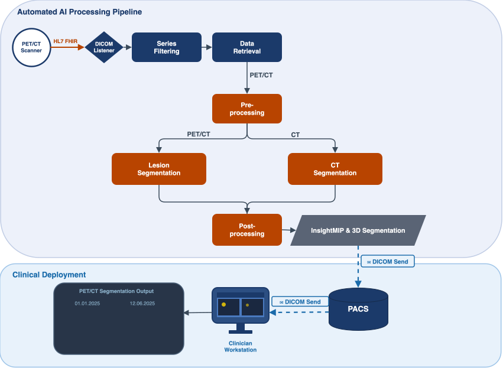
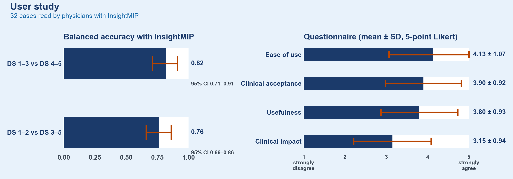
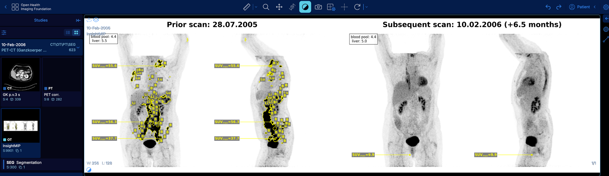

# Integrating AI into the clinical PET/CT workflow for Deauville score assessment in lymphoma

[](LICENSE)





Therapy response in Hodgkin lymphoma is assessed with the Deauville score (DS, 1–5) on [18F]FDG PET/CT: the most intense uptake at the sites of initial disease, seen on the baseline scan before therapy, is scored against two reference organs (mediastinal blood pool and liver). Finding every lesion and measuring SUVmax values by hand is slow, and AI models that could do it rarely reach clinical routine: images have to be exported, processed elsewhere and the results brought back.

This framework integrates the AI into the workflow. It starts by itself when a study arrives and puts an interpretable result into the same study, next to the images the physician is already reading. The framework does the measuring; the physician decides the Deauville score.

1. Finds the PET and CT series of the current and the prior study.
2. Segments the reference organs ([TotalSegmentator](https://github.com/wasserth/TotalSegmentator)) and the lesions ([autoPET III](https://github.com/hakal104/autoPETIII) nnU-Net).
3. Measures SUVmax and builds InsightMIP, stored back in the study in Orthanc together with the lesion segmentation.

<details>
<summary>Glossary</summary>

| Term | Meaning |
|---|---|
| Deauville score (DS) | 5-point scale for the most intense uptake at a site of initial disease, compared with blood pool and liver; DS 1–3 usually counts as complete metabolic response, DS 4–5 as residual disease |
| SUVmax | Highest standardized uptake value in a region |
| MIP | Maximum intensity projection: a 2D image of the brightest voxel along each ray |
| Orthanc | Open-source DICOM server, used here as image archive and viewer (OHIF) |
| HAPI FHIR | FHIR server holding the diagnoses (ICD-10), which decide which workflow a study gets |
| Argo Workflows | Kubernetes workflow engine running each pipeline step as a container |

</details>

## Results

<!-- TODO: number of readers and their experience; the confusion matrices sum to 318 readings -->

Physicians read 32 cases with InsightMIP.





*The result in the OHIF viewer of Orthanc: InsightMIP and the lesion segmentation are stored in the current study, next to the CT and PET. Example results for three autoPET patients are in [data_autopet/results](data_autopet/results).*

## Quickstart (autoPET example)

Loads a public lymphoma patient and gives you a finished InsightMIP in your own Orthanc, about 10–20 min per patient on one GPU. First do the [Installation](#installation), including the automatic start (step 4). Then:

```bash
# load one example patient; the pipeline starts by itself about 1 min later
argo submit -n $NS --from workflowtemplate/pipeline-autopet-example --wait \
  -p patient-id=PETCT_1956667fce -p accession-prefix=AUTOPET-1956

argo list -n $NS
scripts/get-results.sh AUTOPET-1956-FU ./results $NS
```

The example workflow puts the diagnosis (ICD-10 C81.9) into FHIR, downloads both studies from TCIA and names them `<prefix>-BL` (prior) and `<prefix>-FU` (current).

**Docs:** [Parameters and outputs](docs/parameters-and-outputs.md) · [Architecture](docs/architecture.md) · [Extending and PACS](docs/extending.md) · [Troubleshooting](docs/troubleshooting.md)

## Installation

**Requirements:** Kubernetes with at least one NVIDIA GPU node (about 50 GiB RAM for segmentation), a ReadWriteMany storage class, [Argo Workflows](https://argo-workflows.readthedocs.io/) with the `argo` CLI. For the automatic start: an MQTT broker (EMQX) reachable as `emqx-listeners:1883`, the service account `operate-workflow-sa` allowed to create workflows, and [Argo Events](https://argoproj.github.io/argo-events/). All container images are public and pulled automatically.

<!-- TODO: tested Kubernetes / Argo versions, GPU memory, storage per run -->

```bash
export NS=<NAMESPACE>

# 1. Orthanc login
kubectl create secret generic orthanc-login -n $NS \
  --from-literal=username=orthanc \
  --from-literal=password=orthanc \
  --from-literal=users='{"orthanc": "orthanc"}'

# 2. Archive, FHIR server, shared volume
kubectl apply -n $NS -f deploy/orthanc.yaml
kubectl apply -n $NS -f deploy/hapi-fhir.yaml
kubectl apply -n $NS -f config/pvc.yaml

# 3. Workflow templates
kubectl apply -n $NS -f workflows/

# 4. Automatic start (listener, broker, Argo Events)
kubectl apply -k deploy/listener -n $NS
kubectl apply -k deploy/broker -n $NS
kubectl apply -n $NS -f deploy/argo-events/   # set eventBusName there if your EventBus is not called "default"
```

The segmentation steps request `nvidia.com/gpu: 1`; add tolerations or a node selector in [ct-segmentation.yaml](workflows/ct-segmentation.yaml) and [pet-segmentation.yaml](workflows/pet-segmentation.yaml) if your GPU nodes need them. Argo Events or the broker submits the workflows, never both (see [Architecture](docs/architecture.md)).

## Running

Every study needs an AccessionNumber. Send a study to Orthanc, and the pipeline starts by itself when the patient has a matching diagnosis in FHIR. For a local DICOM folder, one command also creates the FHIR Patient and diagnosis:

```bash
python3 scripts/send_test_study.py <DICOM FOLDER> --icd10 C81.9 -n $NS
```

Or start the pipeline by hand:

```bash
argo submit -n $NS --from workflowtemplate/pipeline \
  -p accession-number=<CURRENT ACCESSION> -p prior-accession-number=<PRIOR ACCESSION> --watch
```

<details>
<summary>Other ways to send studies, local autoPET files, port forwarding</summary>

- Orthanc Explorer → *Upload*, or DICOM C-STORE to AE title `PETCT_AI`. Send the patient's earlier study first if you want it as the prior.
- Announce a study already in Orthanc again: `kubectl exec -n $NS deploy/petct-listener -- python /app/listener.py publish <ACCESSION>`
- The three example patients as local files (about 3.5 GB, `data_autopet/<PatientID>/<YYYY-MM-DD>/{CT,PT,SEG}/`):

  ```bash
  scripts/download-autopet.sh                                # the three example patients
  scripts/download-autopet.sh data_autopet PETCT_2f9aec0275  # any other autoPET patient
  ```

- Access from your computer:

  ```bash
  kubectl port-forward svc/orthanc 8042:8042 -n $NS &     # http://localhost:8042/ui/app/, OHIF at /ohif/
  kubectl port-forward svc/hapi-fhir 8080:8080 -n $NS &   # http://localhost:8080/fhir
  ```

</details>

## License and acknowledgements

This repository is licensed under the [Apache License 2.0](LICENSE).

- Lesion segmentation uses the model and code of [hakal104/autoPETIII](https://github.com/hakal104/autoPETIII) (MIT, see [LICENSE-autoPETIII](microservices/pet-segmentation/LICENSE-autoPETIII)): Kalisch H, Hörst F, Herrmann K, Kleesiek J, Seibold C. Autopet III challenge: Incorporating anatomical knowledge into nnUNet for lesion segmentation in PET/CT. arXiv:2409.12155 (2024). https://arxiv.org/abs/2409.12155
- Lesion segmentation is built on [nnU-Net](https://github.com/MIC-DKFZ/nnUNet) (Apache 2.0): Isensee F, Jaeger PF, Kohl SAA, Petersen J, Maier-Hein KH. nnU-Net: a self-configuring method for deep learning-based biomedical image segmentation. Nature Methods 18, 203–211 (2021). https://doi.org/10.1038/s41592-020-01008-z
- Organ segmentation uses [TotalSegmentator](https://github.com/wasserth/TotalSegmentator): Wasserthal J, et al. TotalSegmentator: robust segmentation of 104 anatomic structures in CT images. Radiology: Artificial Intelligence 5(5), e230024 (2023). https://doi.org/10.1148/ryai.230024
- Example images are derived from the FDG-PET-CT-Lesions dataset (CC BY 4.0, see [data_autopet/results/README.md](data_autopet/results/README.md)):
  - Gatidis S, Kuestner T. A whole-body FDG-PET/CT dataset with manually annotated tumor lesions (FDG-PET-CT-Lesions). The Cancer Imaging Archive, 2022. https://doi.org/10.7937/gkr0-xv29
  - Gatidis S, et al. A whole-body FDG-PET/CT Dataset with manually annotated Tumor Lesions. Scientific Data 9, 601 (2022). https://doi.org/10.1038/s41597-022-01718-3
