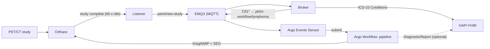

# Architecture

## Automatic start

- **Listener** ([deploy/listener](../deploy/listener)) watches Orthanc. When a study is complete, it publishes it with its prior (the patient's latest earlier study in Orthanc). Studies that are not the patient's newest, or were already processed, go to `petct/skipped` with the reason.
- **Broker** ([deploy/broker](../deploy/broker)) reads the patient's FHIR Conditions and routes the study by [rules.json](../deploy/broker/rules.json) to a workflow topic.
- **Argo Events** ([deploy/argo-events](../deploy/argo-events): EventSource `emqx` + Sensor `petct-lymphoma`) submits `pipeline` for each message on `petct-workflow/lymphoma`.

By default ([broker.yaml](../deploy/broker/broker.yaml): `TRIGGER: "false"`) Argo Events submits the workflows and the broker only routes. Without Argo Events, set `TRIGGER` to `"true"` so the broker submits them.

## Pipeline steps and images

| Step | Image |
|---|---|
| DICOM gateway, viewer | [`orthancteam/orthanc:26.9.0`](https://hub.docker.com/r/orthancteam/orthanc) |
| FHIR server | [`hapiproject/hapi:v8.12.0-1`](https://hub.docker.com/r/hapiproject/hapi) |
| Orthanc / FHIR calls, series selection, saving results | [`negarshahamiri/petct-tools:1.1`](../microservices/petct-tools) |
| DICOM → NIfTI | [`negarshahamiri/dicom-to-nifti:1.0`](../microservices/dicom-to-nifti) |
| Resampling CT → PET grid | [`negarshahamiri/resize-volume:1.0`](../microservices/resize-volume) |
| CT organ segmentation | [`wasserth/totalsegmentator:2.2.1`](https://hub.docker.com/r/wasserth/totalsegmentator) |
| PET lesion segmentation ([autoPET III](https://github.com/hakal104/autoPETIII)) | [`negarshahamiri/pet-segmentation:1.0`](../microservices/pet-segmentation) |
| SUV, reference uptake, MIP | [`negarshahamiri/petct-analysis:1.0`](../microservices/petct-analysis) |
| DICOM listener | [`negarshahamiri/petct-listener:1.0`](../deploy/listener) |
| Broker | [`negarshahamiri/petct-broker:1.0`](../deploy/broker) |

All images are public and pulled automatically; nothing needs to be built.

## Design

- Every step is a container running a command of its image; the pipeline workflow files contain no code.
- Every file in `workflows/` is its own WorkflowTemplate named `pipeline-<file name>` (the main one is just `pipeline`). `pipeline` calls the others with `templateRef`, so they can be reused in other workflows.
- The listener and broker communicate only through MQTT, so either can be replaced independently.

## Repository layout

| Folder | Contents |
|---|---|
| [workflows/](../workflows) | Argo templates; [pipeline.yaml](../workflows/pipeline.yaml) is the main one |
| [microservices/](../microservices) | source and Dockerfile of each image |
| [deploy/](../deploy) | Orthanc, HAPI FHIR, automatic start (listener, broker, Argo Events) |
| [config/](../config) | shared volume |
| [scripts/](../scripts) | download test data, send a test study, fetch results |
| [docs/](.) | this documentation |
| [data_autopet/results/](../data_autopet/results) | example results |
